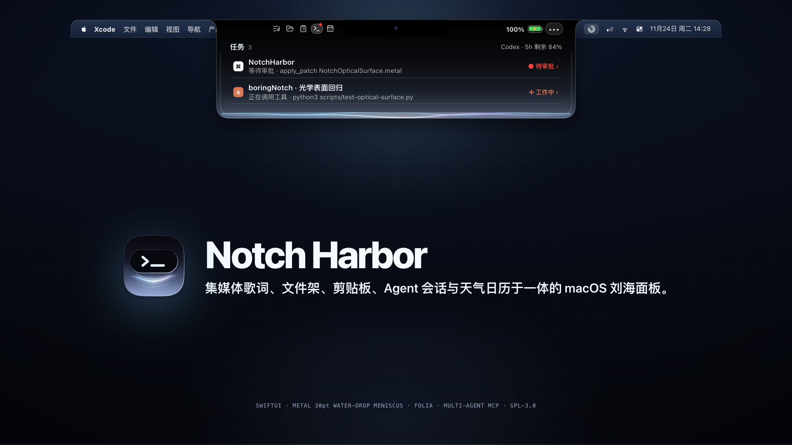
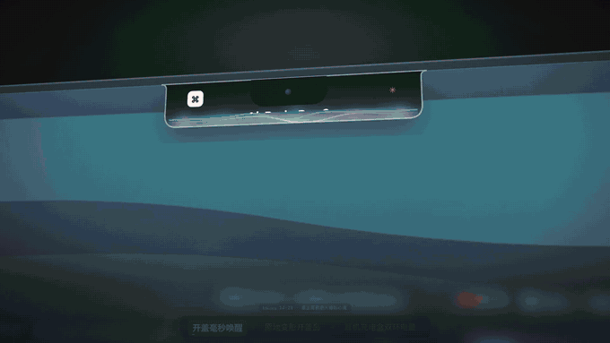
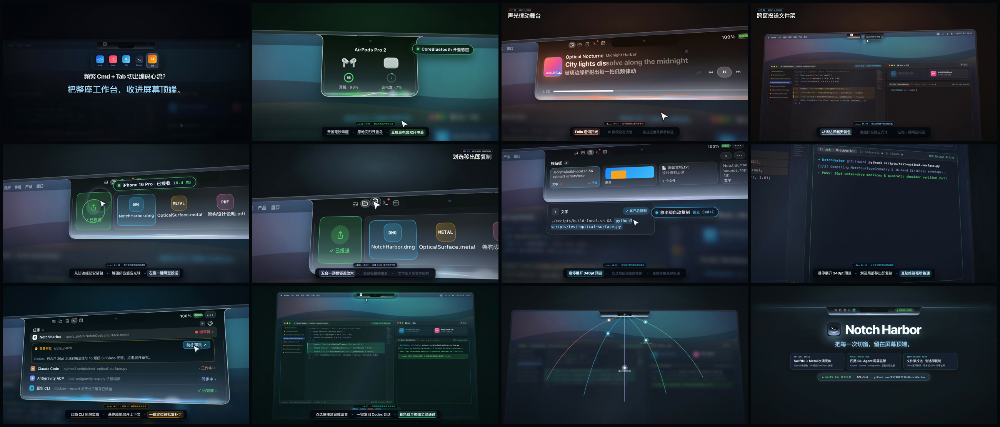

# Notch Harbor

<p align="center">
  
</p>

<p align="center">
  <strong>把每一次切窗，留在屏幕顶端。</strong><br />
  面向 macOS 14+ 的原生光学刘海工作台 —— 融合 30pt Metal 水滴折射壳体、媒体与 Folia 逐词歌词、跨窗文件架与隔空投送、滚轮局部划选剪贴板、多路 CLI Agent 同屏监管与菜单栏 65W 功率丝带。
</p>

<p align="center">
  
</p>

---

## 核心特性

1. **SwiftUI + Metal 30pt 水滴折射壳体 (`NotchOpticalSurface.metal`)**
   - 二次凹肩硬件贴合曲线（展开态 `top: 19pt, bottom: 24pt`），顶部黑色吸光肩平滑过渡至底部 30pt 水滴斜角折射边缘与 16 频段 SiriGlass 音频光波，支持与 macOS 原生系统灵动岛自动避让协同。
2. **媒体声光舞台与 Folia 逐词同步歌词**
   - 通过内置 `MediaRemoteAdapter` 自动识别 Apple Music、网易云音乐、QQ 音乐、Spotify 及浏览器播放源，支持封面取色氛围光、Folia 逐词扫光歌词、点击行跳转进度，以及 AirPods 开盖 CoreBluetooth 双环电量动效。
3. **跨窗文件暂存架与一键隔空投送 (`Shelf & AirDrop`)**
   - 从桌面或访达抓起文件移向顶部闭岛，即刻浮现液态玻璃感应光球唤醒文件架；支持多文件暂存、重命名，向左拖入绿色投送区即可直接拉起 `AirDrop` 隔空投送。
4. **滚轮横滑剪贴板与悬停局部划选自动复制**
   - 本机持久化最近 50 条文字、图片与多文件记录，支持置顶与过滤；悬停长文本自动向下展开 `340pt` 全文预览卡，直接鼠标拖选任意子串后**移出刘海区域即自动写入系统剪贴板**，省去额外按键。
5. **多路 CLI Agent 同屏监管、岛内回复与菜单栏监控**
   - 同屏聚合 **Codex、Claude Code、Antigravity ACP、豆包 CLI** 等多路本地会话状态，支持待审批红点提醒、悬停上下文快览、快捷建议/语音岛内直回，以及任务完成时的硬件边缘流光环绕（`AgentCompletionHalo`）。
   - 右上角菜单栏状态弹窗（`276pt`）支持切换查看 AI 配额双环、Apple Silicon 实时充电/整机功耗丝带（`MenuPowerTelemetry`）与 60 秒内存压力曲线。
6. **气象预警、七日滚轮日程与首次启动高光引导**
   - 左侧展示实时气温与本地降水/气象台预警，右侧通过七日横向滚轮速览日历会议与提醒事项。
   - 内置**首次启动高光镂空引导教程（`NotchSpotlightGuide`）**，逐步高亮左翼五合一顶栏与各工作台核心手势；也可随时通过岛内 `•••` 菜单或「设置 → 通用 / 关于」一键重播。

<p align="center">
  
</p>

---

## 本地构建与运行

### 环境要求

- **macOS 14.0+**（SiriGlass 实时音频光谱需 macOS 14.4+）
- **Xcode 16+**（含 Metal 工具链）
- **Node.js 18+ & npm**（用于打包内嵌 Folia 歌词组件）

### 一键构建 Release 应用包

```sh
./scripts/build-local.sh
```

- 构建产物输出至 `.build/xcode/Build/Products/Release/Notch Harbor.app`，不会覆盖或干扰 `/Applications` 中正在运行的正式版本。
- 构建脚本会自动拉取锁定的 Swift Package 与 npm 依赖、预编译离线 CSP 保护的 Folia 歌词视图，并将 `LICENSE` 与 `THIRD_PARTY_LICENSES` 随包嵌入。
- 默认使用本地临时签名（ad-hoc），也可通过环境变量 `NOTCH_HARBOR_SIGNING_IDENTITY` 指定开发者签名证书。
- 日常开发调试可直接打开 `NotchHarbor.xcodeproj`；如需直接启动并预览高光使用引导，可传入 `--spotlight-guide` 启动参数。

---

## 可选：多路 Agent 状态桥与 MCP 接入

Notch Harbor 默认零侵入运行，不会自动修改任何外部 CLI 配置。如需接入本地 AI 编程助手实时状态，可按需启用：

1. **启动用户级 Activity Bridge 守护进程**：
   ```sh
   python3 scripts/install-activity-bridge.py
   ```
2. **安装 Gemini / Antigravity 钩子（可选）**：
   ```sh
   python3 scripts/install-antigravity-hook.py
   ```
3. **stdio MCP 接入（可选）**：
   将 `/usr/bin/python3` 作为命令、仓库内 `scripts/notch-harbor-mcp.py` 的绝对路径作为参数接入任意支持 MCP 的客户端，即可调用 `notch_harbor_status`、`set_agent_activity` 与 `set_doubao_activity`。详见 [活动来源与可选 Agent 接入说明](docs/ACTIVITY_SOURCES.md)。

---

## 目录结构

- `boringNotch/` — 主应用 SwiftUI 视图、模型、设置面板、`NotchOpticalSurface.metal` 着色器与交互引导。
- `BoringNotchXPCHelper/` — 辅助功能与 SMC 功耗读取 XPC 服务。
- `mediaremote-adapter/` — 系统媒体控制桥与运行时探测组件。
- `THIRD_PARTY/` — 锁定的第三方组件源码、补丁说明与原始许可文件。
- `scripts/` — 本地构建脚本、可选 Agent 桥接器、MCP 服务端及 25 项自动化回归测试。

---

## 自动化回归测试

仓库内置针对光学几何、Metal 着色器、系统灵动岛避让、剪贴板、文件拖拽、歌词匹配、功耗遥测及高光引导几何的回归测试套件：

```sh
for t in scripts/test-*.py; do
  python3 "$t"
done
```

---

## 开源许可与致谢

Notch Harbor 派生自 [The Bored Team / boring.notch](https://github.com/TheBoredTeam/boring.notch)，遵循 [GPL-3.0](LICENSE) 开源许可发布。

项目中使用的第三方开源组件（包括 MediaRemoteAdapter、Calendr、DynamicNotchKit、NotchDrop、SiriGlass、Maccy、Shima、apple-ble、Folia、Lucide、PowerFlow、AgentNotch、useAnimations 等）均保留完整署名与许可证，详见 [THIRD_PARTY_LICENSES](THIRD_PARTY_LICENSES) 与 [`THIRD_PARTY/`](THIRD_PARTY)。
